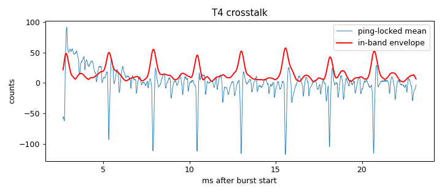

# Signal-chain profile: ad828-v1-bias3k6-ampPSU

Updated 2026-10-14T14:13:35 · git ec8d977

## Hardware

- **description:** Same as ad828-v1-bias3k6 (3.6k bias on node, pad lifted, no mic, amp input connected) but speaker amp now on its own 5V/850mA supply instead of ESP32 VIN

## T4 Burst crosstalk (input terminated, amp connected)

- Ping-locked signal: 23.7 counts RMS (11.9 below 300 Hz, 15 in 2000-6000 Hz)
- In-band crosstalk falls below 3× the per-ping noise 2.67 ms after the burst (first sample at 2.67 ms)

