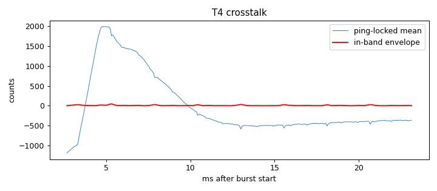

# Signal-chain profile: ad828-v1-bias3k6

Updated 2026-10-14T13:26:11 · git ec8d977

## Hardware

- **description:** Same preamp as ad828-v1; pad disconnected from node; 3.6k bias resistor node->3.3V reinstalled; electret removed; speaker amp connected

## T4 Burst crosstalk (input terminated, amp connected)

- Ping-locked signal: 767 counts RMS (748 below 300 Hz, 9.03 in 2000-6000 Hz)
- In-band crosstalk falls below 3× the per-ping noise 5.35 ms after the burst (first sample at 2.67 ms)

