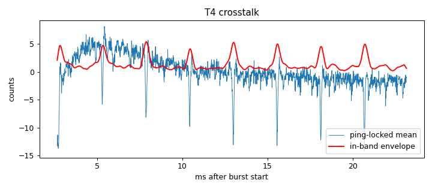

# Signal-chain profile: ad828-v1-biasRC-R2k2-supplyFilter

Updated 2026-10-14T15:21:53 · git 4b46e37

## Hardware

- **description:** Same as ad828-v1-biasRC-R2k2 (1.8k+1.8k/100uF bias, 2.2k node->gnd, pad lifted, no mic) plus preamp supply filter 22R+100uF+0.1uF at its pins, single-point ground, amp supply on, GPIO25 wire connected (assumed)

## T4 Burst crosstalk (input terminated, amp connected)

- Ping-locked signal: 2.88 counts RMS (2.04 below 300 Hz, 1.38 in 2000-6000 Hz)
- In-band crosstalk falls below 3× the per-ping noise 2.67 ms after the burst (first sample at 2.67 ms)

