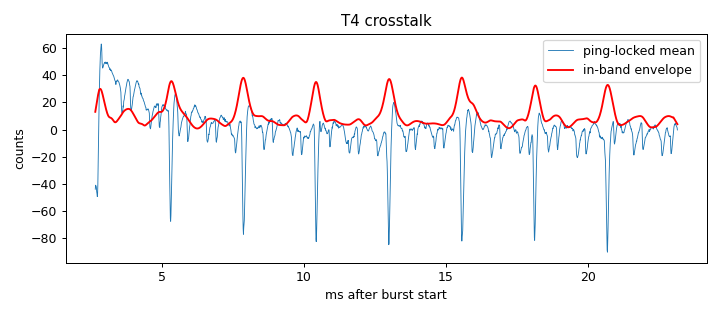

# Signal-chain profile: ad828-v1-biasRC-R2k2-wireOff

Updated 2026-10-14T14:43:32 · git 4b46e37

## Hardware

- **description:** Same as ad828-v1-biasRC-R2k2 but GPIO25-to-amp-input wire disconnected (amp off, lamps off)

## T4 Burst crosstalk (input terminated, amp connected)

- Ping-locked signal: 17.9 counts RMS (9.57 below 300 Hz, 10.3 in 2000-6000 Hz)
- In-band crosstalk falls below 3× the per-ping noise 2.67 ms after the burst (first sample at 2.67 ms)

