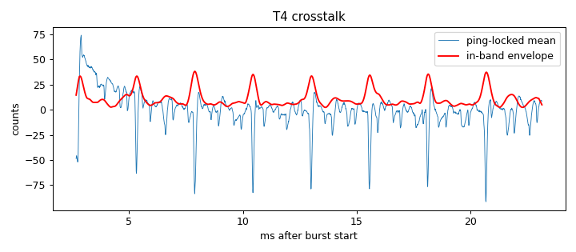

# Signal-chain profile: ad828-v1-biasRC-R2k2

Updated 2026-10-14T14:37:46 · git 4b46e37

## Hardware

- **description:** Same as ad828-v1-biasRC-ampOff-lampsOff but 2.2k resistor from node to ground (short leads) in place of open node; amp off; lamps off

## T4 Burst crosstalk (input terminated, amp connected)

- Ping-locked signal: 18.2 counts RMS (9.73 below 300 Hz, 10.4 in 2000-6000 Hz)
- In-band crosstalk falls below 3× the per-ping noise 2.67 ms after the burst (first sample at 2.67 ms)

