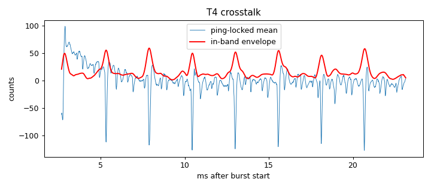

# Signal-chain profile: ad828-v1-biasRC-ampOff-lampsOff

Updated 2026-10-14T14:31:42 · git 4b46e37

## Hardware

- **description:** Same as ad828-v1-biasRC-ampOff but LED lamps nearby switched OFF

## T4 Burst crosstalk (input terminated, amp connected)

- Ping-locked signal: 26.3 counts RMS (14.1 below 300 Hz, 15.7 in 2000-6000 Hz)
- In-band crosstalk falls below 3× the per-ping noise 2.67 ms after the burst (first sample at 2.67 ms)

