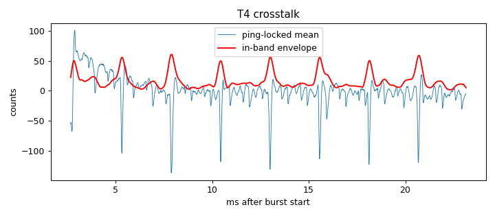

# Signal-chain profile: ad828-v1-biasRC-ampOff

Updated 2026-10-14T14:28:01 · git 4b46e37

## Hardware

- **description:** Same as ad828-v1-biasRC but speaker amp supply switched OFF (amp input still connected); LED lamps nearby on

## T4 Burst crosstalk (input terminated, amp connected)

- Ping-locked signal: 26.4 counts RMS (14.2 below 300 Hz, 16.1 in 2000-6000 Hz)
- In-band crosstalk falls below 3× the per-ping noise 2.67 ms after the burst (first sample at 2.67 ms)

