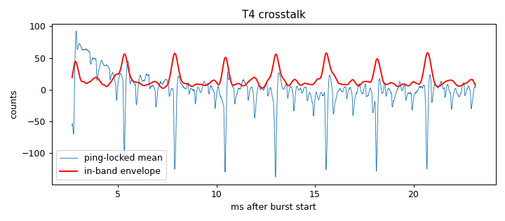

# Signal-chain profile: ad828-v1-biasRC

Updated 2026-10-14T14:22:01 · git 4b46e37

## Hardware

- **description:** Same as ad828-v1-bias3k6-ampPSU but mic bias is 1.8k+1.8k with 100uF to ground at the junction; amp on own 5V/850mA supply; pad lifted; no mic; amp input connected

## T4 Burst crosstalk (input terminated, amp connected)

- Ping-locked signal: 28 counts RMS (14.9 below 300 Hz, 15.8 in 2000-6000 Hz)
- In-band crosstalk falls below 3× the per-ping noise 2.67 ms after the burst (first sample at 2.67 ms)

