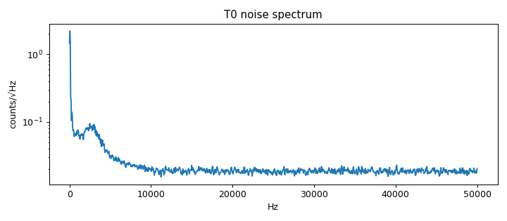

# Signal-chain profile: ad828-v1-mic-ampOff

Updated 2026-10-14T15:30:12 · git 5bec6e8

## Hardware

- **description:** Real electret mic + bias network installed, preamp with filtered supply, speaker amp disconnected; quiet-room noise

## T0 Noise (input terminated)

- Per-ping noise: 21.8 counts RMS (3.63 in 2-6 kHz)
- Ping-locked (burst-synchronous) signal: 20.6 counts RMS
- Floor: 0.0192 counts/√Hz; DC 1814.2 counts
- Spurs: 293 Hz, 2490 Hz, 2588 Hz, 2686 Hz, 2832 Hz, 2930 Hz, 3027 Hz, 3125 Hz

