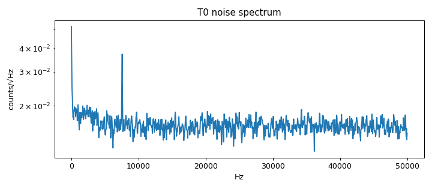
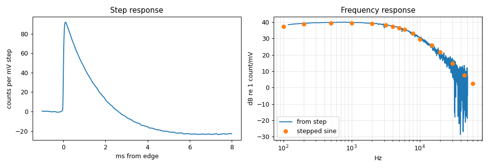
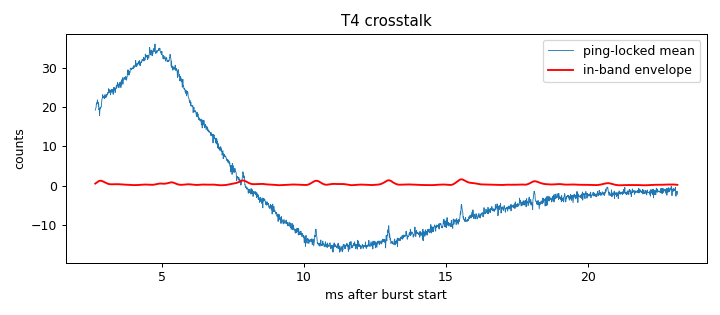

# Signal-chain profile: ad828-v1

Updated 2026-10-14T13:09:08 · git ec8d977

## Hardware

- **description:** AD828 two-stage inverting preamp (2.2k in / 20k fb, 1nF across each 20k); input 10uF+2.2k; output 0.1uF into 10k/10k ADC bias (1.65V); mic bias R removed, electret removed; speaker amp disconnected. Pad: 4.7k/47 (nominal, 5%)

## Setup

- **r_series_div100:** 4700.0
- **r_shunt:** 47.0
- **pad_ratio_div100:** 0.009900990099009901
- **raw_pair_swap_corrected_offline:** ['sine_100.csv', 'sine_1000.csv', 'sine_10000.csv', 'sine_15000.csv', 'sine_200.csv', 'sine_2000.csv', 'sine_3200.csv', 'sine_4000.csv', 'sine_500.csv', 'sine_5000.csv', 'sine_6000.csv', 'sine_8000.csv', 'step.csv']
- **note_pair_swap:** These captures were recorded before the firmware swapped back the ESP32 ADC DMA's adjacent-sample pairs (see CLAUDE.md); adjacent pairs were swapped back offline in place. Later captures need no correction.

## T0 Noise (input terminated)

- Per-ping noise: 3.45 counts RMS (1.01 in 2-6 kHz)
- Ping-locked (burst-synchronous) signal: 0.588 counts RMS
- Floor: 0.0157 counts/√Hz; DC 1808.7 counts
- Input-referred: 37 µV RMS (using gain at the reference frequency)
- Spurs: 7568 Hz

## T1 Step response

- 69 edges averaged; peak gain 100 counts/mV (≈38.2 dB at the nominal ADC scale) at 779 Hz
- −3 dB corners: low n/a Hz, high 2.99e+03 Hz (frequency resolution 111 Hz, so the low corner is coarse)
- Rise 10-90%: 70 µs; settles to 2% 4.99 ms after peak

## T2 Stepped sine

| f gen (Hz) | f seen (Hz) | gain (counts/mV) | dB nominal | THD % | clipped |
|---|---|---|---|---|---|
| 100 | 99 | 72.7 | 35.3 | 1.59 | 0 |
| 200 | 200 | 87.4 | 37 | 1.9 | 0 |
| 500 | 500 | 92.5 | 37.4 | 1.67 | 0 |
| 1000 | 998 | 93.3 | 37.5 | 1.21 | 0 |
| 2000 | 1999 | 89.4 | 37.1 | 1.14 | 0 |
| 3200 | 3201 | 81.2 | 36.3 | 1.06 | 0 |
| 4000 | 4001 | 74.6 | 35.6 | 0.974 | 0 |
| 5000 | 4999 | 66.9 | 34.6 | 0.652 | 0 |
| 6000 | 6001 | 59.1 | 33.6 | 0.925 | 0 |
| 8000 | 8000 | 45 | 31.2 | 0.546 | 0 |
| 10000 | 10000 | 29.6 | 27.5 | 3.71 | 0 |
| 15000 | 15048 | 19.6 | 24 | 0.537 | 0 |
| 20000 | 20014 | 12.3 | 19.9 | 0.906 | 0 |
| 30000 | 29997 | 5.59 | 13.1 | 2.38 | 0 |
| 45000 | 45006 | 2.4 | 5.71 | 7.1 | 0 |
| 60000 | 39997 (alias) | 1.34 | 0.689 | 7.29 | 0 |

## T4 Burst crosstalk (input terminated, amp connected)

- Ping-locked signal: 14.5 counts RMS (14.4 below 300 Hz, 0.344 in 2000-6000 Hz)
- In-band crosstalk falls below 3× the per-ping noise 2.67 ms after the burst (first sample at 2.67 ms)

